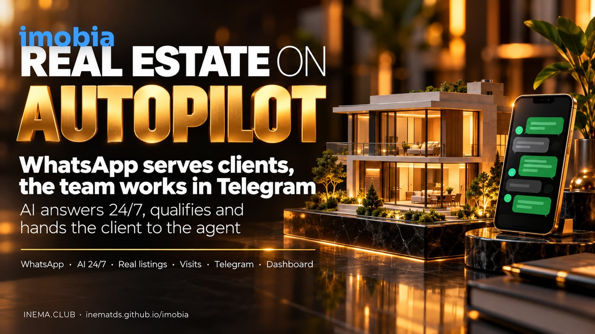

# imobia — real estate on autopilot

[](https://inematds.github.io/imobia/guia/en/)

**🇧🇷 [Português](README.md) · 🇺🇸 [English](README.en.md) · 🇪🇸 [Español](README.es.md)**

> **Status:** proposal under discussion. The system has not been built yet.

## What it is

imobia is the plan for an in-house customer service system for a real estate agency that sells and rents properties, with 5 agents. The client sends a WhatsApp message and an AI answers right away, understands what they are looking for and shows only properties that exist in the listings. When it is time to visit or negotiate, the conversation moves to an agent, who replies through Telegram. There are no forms to fill in: whatever can be automatic, is.

## 📖 Project page

Landing page with the plan: **https://inematds.github.io/imobia/guia/en/**

## Documents (in Portuguese)

- [`docs/plano-arquitetura.md`](docs/plano-arquitetura.md): proposed architecture, components, data, risks and phases.
- [`docs/discussao-2026-10-13.md`](docs/discussao-2026-10-13.md): record of the conversation that started the project.
- [`docs/pesquisa-2026-10-13.md`](docs/pesquisa-2026-10-13.md): references analyzed (imob360, wacrm, EspoCRM, Chatwoot, Twenty, Evolution API).

## Architecture at a glance

```
Client (WhatsApp) → Evolution API → imobia app (AI + matching + scheduler) → Postgres
                                          ↓
                         Telegram bot (team) · Web dashboard (read-only)
```

## Open decision

How the team uses Telegram: **A)** one topic per client in a group (recommended), **B)** private chat per agent, **C)** mixed.

---
[INEMA.CLUB](https://inema.club)
